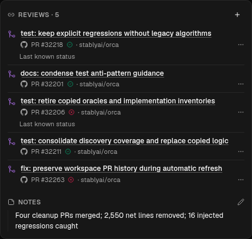
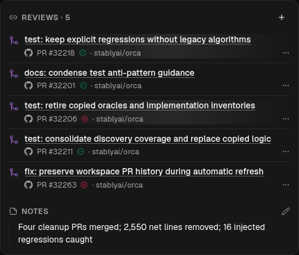
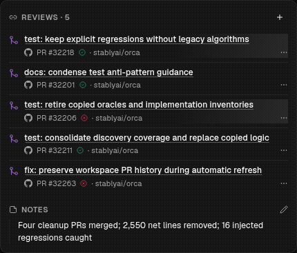

# Inline reference status

“Last known status” added a third line to stale linked references. When a refresh
cleared it, each affected row shrank by 20px and moved the content below it.
Stale rows now use a subtle shimmer without adding an icon or a visible label.
Screen readers retain the status label, and reduced motion uses a still tint.

| Before                                                    | After                                             |
| --------------------------------------------------------- | ------------------------------------------------- |
|  |  |

Captured with Playwright CDP from a hidden Electron renderer on an isolated Xvfb
display, rendering the actual `WorktreeCardLinkedItemsSection` and application CSS
with five seeded PRs and two stale references. These are component captures, not
screenshots of a signed-in app session.

Verified in light and dark themes at 320px and 430px widths: switching those two
references from stale to fresh reduced the original card from 407px to 367px.
After the change, both states measure 367px, with identical row positions and no
horizontal overflow. Only stale rows animate; clearing stale status removes the
animation. Reduced motion disables movement while retaining a subtle highlight.
