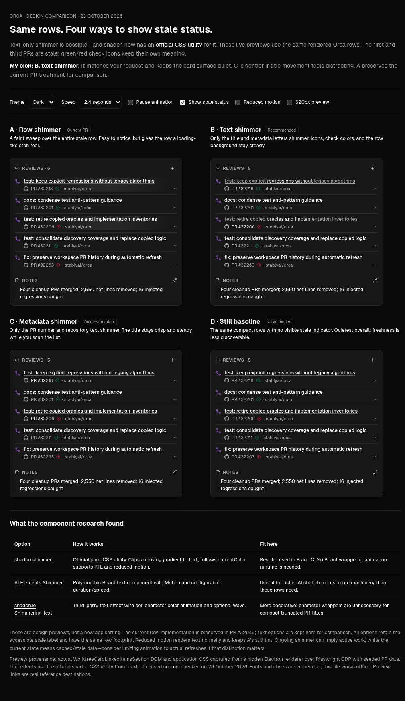
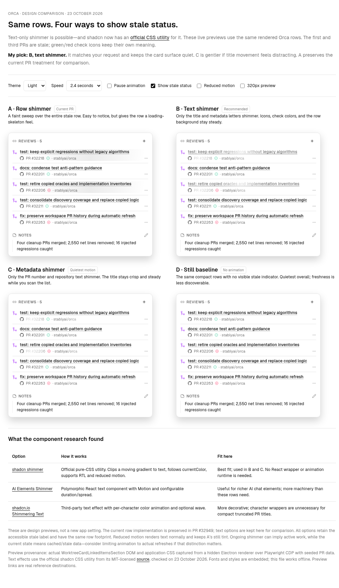

# Stale-reference animation options

[Open the live comparison](index.html) (download/open locally when viewing on GitHub).
The standalone report embeds the actual Orca component markup, application styles,
and font. Controls switch theme, speed, stale status, reduced motion, pause, and
320px previews. It works offline.

| Option              | Treatment                           | Tradeoff                                                             |
| ------------------- | ----------------------------------- | -------------------------------------------------------------------- |
| A                   | Current whole-row shimmer           | Most noticeable; also animates the surface.                          |
| **B — recommended** | **Title and metadata text shimmer** | Closest to the requested effect; keeps icons and the surface steady. |
| C                   | Metadata text shimmer               | Quieter; the title stays steady while scanning.                      |
| D                   | Still baseline                      | Least distracting; no visible freshness cue.                         |

B and C use shadcn's [official shimmer utility](https://ui.shadcn.com/docs/utils/shimmer),
a pure-CSS text effect with RTL and reduced-motion support. Its
[MIT-licensed source](https://github.com/shadcn-ui/ui/blob/main/packages/shadcn/src/tailwind.css)
was checked on 23 October 2026. This does not require a React animation component.
[AI Elements Shimmer](https://ai-sdk.dev/elements/components/shimmer) is a more
configurable React/Motion alternative. The third-party
[shadcn.io Shimmering Text](https://www.shadcn.io/text/shimmering-text) uses character
animations and optional waves, which are unnecessary for these truncated titles.

The current row implementation and its original captures remain preserved in the
parent directory and PR. Text treatments are comparison prototypes; no new app
setting or default was added.

All four previews were checked through Playwright CDP in a hidden Electron
renderer: identical 367px card heights before/after clearing stale state, light/dark
at 320px and 430px, controls, OS/manual reduced motion, and no page overflow at
375px. The two stale rows alone animate. Text variants leave check icons unchanged.

